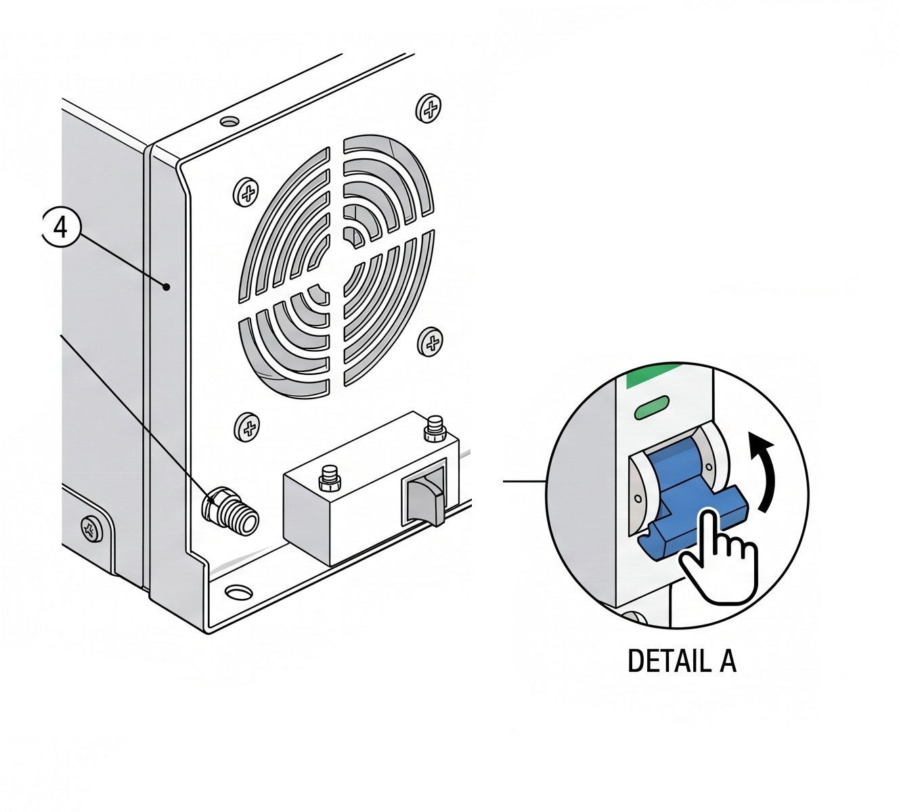
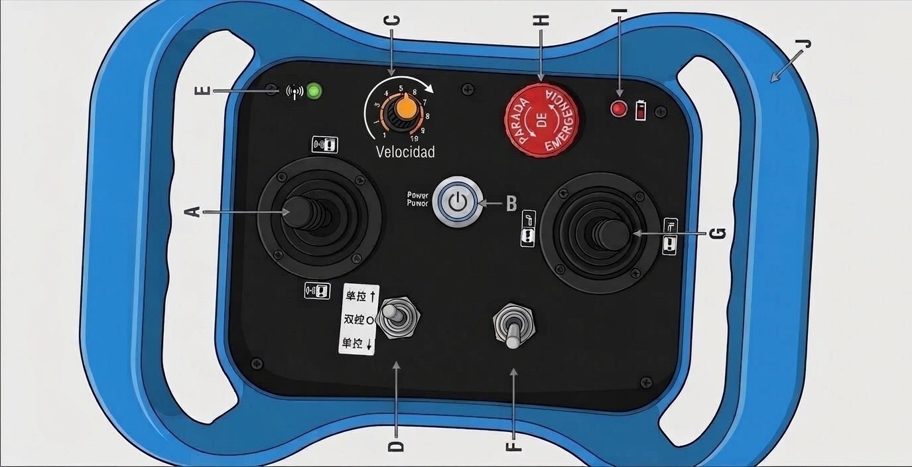

<!-- Encabezado / Portada con QR incrustado -->

  <h1>Manual de Uso y Operación</h1>
  <h2>Electric Moving Ground Tank</h2>
  
<b>Modelo:</b> Serie DT (Tanque de Transporte Eléctrico de Carga Pesada)

  
<b>Sistema de Control:</b> Radiocontrol inalámbrico de 2.4 GHz

  

---

## 1. Descripción del Equipo

El **Electric Moving Ground Tank** es un vehículo de transporte pesado de accionamiento eléctrico con control remoto inalámbrico[cite: 9]. Diseñado para el movimiento de maquinaria, estructuras de acero y cargas de gran tonelaje en distancias cortas, reemplaza los sistemas de elevación e instalaciones de rodillos tradicionales[cite: 9].

* **Capacidad de giro:** 360° direccional sobre su propio eje[cite: 9].
* **Tracción:** Sistema de motor dual de alto par[cite: 9].
* **Entorno operativo:** Pisos industriales planos y duros (hormigón, chapa de acero) con pendiente menor a 15°[cite: 9].

---

## 2. Puesta en Marcha

Realice los siguientes pasos antes de iniciar el desplazamiento con carga:

1. **Verificación mecánica y del entorno:** Confirme que el piso esté firme, limpio y con pendiente menor a 15°, y que el chasis, ruedas y plato giratorio no presenten daños[cite: 8, 9].
2. **Conexión y protección térmica:** Asegure la alimentación de la batería (48 V) y accione la llave térmica/interruptor de potencia hacia la posición de encendido, verificando que las rejillas de ventilación estén libres de obstrucciones (*ver Figura 2, detalle de accionamiento*)[cite: 15, 24].
3. **Encendido y enlace del control remoto:** Verifique que el botón de parada de emergencia esté liberado/desenclavado, encienda el control remoto y confirme el indicador de enlace inalámbrico antes de mover cualquier mando[cite: 6, 7].

   
  <em>Figura 2. Ubicación de ventilación/conexión y accionamiento de la llave de corte (Detalle A)[cite: 24].</em>

---

## 3. Disposición del Control Remoto e Indicadores

Según el transmisor intalado en el equipo, será el mando a utilizar. Ambos mandos toma como guía las etiquetas de las figuras:

* **Parada de Emergencia:** Botón rojo de corte inmediato (`H` en el control azul; `E` en el control rojo). Debe estar liberado para permitir el movimiento[cite: 6, 25, 26].
* **Encendido (`Power`):** Pulsador central de alimentación del transmisor (`B` en el control azul; `F` en el control rojo)[cite: 25, 26].
* **Regulador de Velocidad:** Perilla graduada para limitar la velocidad máxima (`C` en el control azul; `B` en el control rojo)[cite: 6, 25, 26].
* **Joysticks de Marcha y Giro:** Controlan avance/retroceso y dirección/rotación (`A` y `G` en el control azul; `C` en el control rojo)[cite: 6, 25, 26].
* **Indicadores de Estado:** Señales luminosas de enlace/transmisión y estado de batería (`E` y `I` en el control azul; `A` y `D` en el control rojo)[cite: 7, 25, 26].

  
  &nbsp;&nbsp;&nbsp;&nbsp;
   
  <em>Figura 3. Identificación de controles e indicadores en transmisor azul (izquierda) y rojo (derecha)[cite: 25, 26].</em>

### Indicadores LED y Alarmas de Diagnóstico
* **LED Batería:** Encendido continuo (batería ok) / Parpadeo (subvoltaje / batería baja)[cite: 7].
* **Alarmas Motor Izquierdo / Derecho:**
  * *Sin luz:* Operación normal[cite: 7].
  * *2 destellos/segundo + Zumbador:* Falta de fase (Phase loss)[cite: 7].
  * *1 destello/segundo + Zumbador:* Sobrecorriente (Overcurrent)[cite: 7].

---

## 3. Disposición del Control Remoto e Indicadores

Ambos controles comparten la misma distribución de mandos; se toma como referencia visual la ilustración del mando rojo (*Figura 3*)[cite: 25, 26]. **El transmisor del mando azul es el que se encuentra vinculado al equipo.**

* **Parada de Emergencia (`E`):** Botón rojo de corte inmediato; debe estar liberado/desenclavado para operar[cite: 6, 26].
* **Encendido / Power (`F`):** Pulsador central de alimentación del control[cite: 26].
* **Regulador de Velocidad (`B`):** Perilla graduada para limitar la velocidad máxima[cite: 6, 26].
* **Joysticks (`C` y mando derecho):** Controlan avance/retroceso, dirección y giro[cite: 6, 26].
* **Indicadores (`A` y `D`):** Señales luminosas de enlace/transmisión y estado de batería[cite: 7, 26].
* **Selectores inferiores (`G`):** Controles auxiliares/de maniobra según configuración[cite: 26].

> **Nota sobre el mando azul (Selector de unidad):** En el control azul, la palanquita identificada como **Lamp** selecciona el modo de comando entre **1 equipo, 2 equipos o ambos**.

   
  <em>Figura 3. Distribución general de mandos e indicadores en el control de referencia.</em>

   
  <em>Figura 4. Selector Lamp en el mando azul para elegir entre 1 equipo, 2 equipos o ambos.</em>

---

## 4. Procedimiento de Operación Paso a Paso

1. **Posicionamiento:** Deslizar el tanque por debajo de la carga asegurando que el centro de gravedad del objeto coincida con el centro del plato giratorio del equipo[cite: 8].
2. **Elevación y Asentamiento:** Utilizar un gato hidráulico para elevar la carga, ubicar el tanque en posición central y bajar lentamente la carga garantizando que las ruedas asienten firmemente[cite: 8].
3. **Encendido:** Conectar la batería, encender la llave de potencia principal y verificar la luz de estado[cite: 8].
4. **Desplazamiento:** Operar el radiocontrol comenzando a baja velocidad[cite: 8]. Mantener velocidad constante y evitar giros bruscos durante el trayecto[cite: 8].
5. **Estacionamiento y Descarga:** Al llegar a destino, detener el equipo, elevar la carga con el gato hidráulico, retirar el tanque y asegurar la carga sobre el suelo[cite: 8].

> **ADVERTENCIA DE SEGURIDAD:** 
> * NO realice maniobras de cambio de dirección mientras el equipo esté acelerando bruscamente a máxima carga[cite: 8].
> * El equipo NO debe utilizarse como soporte estático permanente para soportar peso por largos períodos de tiempo[cite: 4].
> * Durante el transporte del propio equipo, la batería debe ser removida o colocada en un lateral protegido para evitar impactos[cite: 4].

---

## 5. Guía de Solución de Problemas (Troubleshooting)

Si el tanque eléctrico no realiza el viraje o movimiento esperado, siga este diagrama de diagnóstico básico:

| Problema | Causa Probable | Verificación / Solución |
| :--- | :--- | :--- |
| **Sin respuesta general** | Circuito desconectado o batería baja | Desconectar y volver a enchufar los conectores principales. Comprobar carga de batería[cite: 4, 9]. |
| **Un motor gira pero el equipo no se mueve** | Falla en caja reductora | Levantar el tanque e intentar girar las ruedas manualmente sin energía. Si giran libres, la caja reductora está dañada[cite: 4]. |
| **Un motor no responde en absoluto** | Falla de controlador o motor quemado | Cambiar de posición las fases (cables de salida del controlador) entre motor izquierdo y derecho. Si la falla se traslada de lado, el controlador está roto; si permanece en el mismo lado, el motor/bobinado está quemado[cite: 4]. |
| **Zumbador de alarma activo** | Sobrecorriente o pérdida de fase | Detener el equipo, verificar bloqueos en las ruedas y revisar las conexiones de los cables del controlador[cite: 7]. |

---
## 6. Especificaciones y Seguridad de la Batería

A continuación se detallan los parámetros eléctricos nominales y las normas de seguridad indicadas en la etiqueta de la batería del equipo:

### Datos Técnicos y Certificado de Calidad

| Parámetro / Campo | Valor de Etiqueta |
| :--- | :--- |
| **Nombre del producto** | Batería de litio de potencia industrial para equipo |
| **Marca de celdas** | 中航 (CALB)[cite: 29] |
| **Modelo / Especificación** | 48V 60Ah[cite: 29] |
| **Tensión de trabajo** | 39 V – 54,6 V[cite: 29] |
| **Corriente de trabajo** | 10 – 100 A[cite: 29] |
| **Tensión de carga** | 54,6 V[cite: 29] |
| **Norma de ejecución** | GB/T 36672-2018[cite: 29] |
| **Fecha de producción** | 2026-07-21[cite: 29] |
| **Inspector** | 01[cite: 29] |

---

### Advertencias de Seguridad (Warning)

| Precaución / Regla | Indicación de la Etiqueta |
| :--- | :--- |
| **Cobertura de seguro** | Este producto cuenta con póliza de seguro de compañía aseguradora en China[cite: 29]. |
| **No abrir la batería** | No abra ni desarme la batería por cuenta propia; abrirla anula la garantía[cite: 29]. |
| **Almacenamiento prolongado** | Mantener lejos del agua y la humedad; para almacenamiento prolongado, conservar a aproximadamente **60 %** de carga[cite: 29]. |
| **Temperatura y fuego** | No colocar en zonas de alta temperatura ni arrojar al fuego o fuentes de calor (riesgo de incendio/explosión)[cite: 29]. |
| **Cargador y polaridad** | Usar únicamente el cargador dedicado para baterías de litio; no invertir los polos positivo y negativo[cite: 29]. |
| **Daños por impacto o caída** | Evitar golpes fuertes, compresión o caídas de la batería (riesgo de daño interno o incendio)[cite: 29]. |
| **Entorno de carga** | Al cargar, retirar o mantener libre de materiales combustibles/inflamables a al menos **2 metros** alrededor; prohibido cargar cerca de materiales inflamables o en interiores no aptos[cite: 29]. |
| **Batería dañada o abultada** | Si la batería presenta deformación/abultamiento o daño severo, suspender su uso de inmediato[cite: 29]. |
| **Carga segura** | Para cargar, extraer o aislar el pack según corresponda y cargar a al menos **2 metros** de materiales inflamables; no usar clavos/puntas metálicas ni cargar en reversa[cite: 29]. |

---

## 7. Almacenamiento y Mantenimiento Preventivo

* **Lugar de Almacenamiento:** Guardar en un espacio seco, ventilado, alejado de la luz solar directa y libre de sustancias corrosivas[cite: 3].
* **Cuidado de Baterías:** Si el equipo permanecerá fuera de servicio por un período prolongado, asegúrese de almacenar la batería con un nivel de carga no inferior al **60%**[cite: 3].
* **Limpieza:** Limpiar periódicamente el polvo y detritos acumulados en la banda de rodadura de las ruedas y la base del plato giratorio[cite: 8, 9].