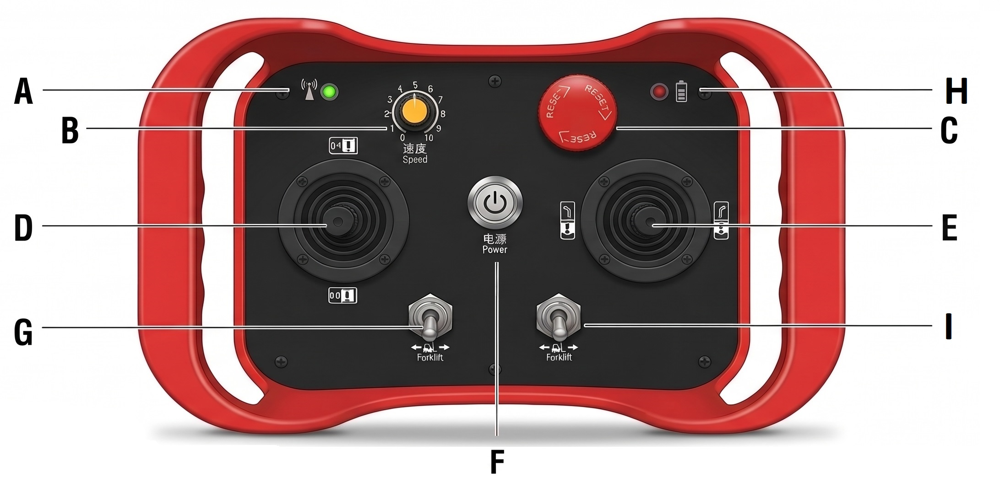
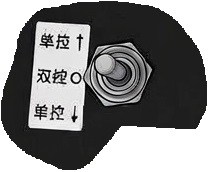

<!-- Encabezado / Portada con QR incrustado -->

  <h1>Manual de Uso y Operación</h1>
  <h2>Electric Moving Ground Tank</h2>
  
<b>Modelo:</b> Serie DT (Tanque de Transporte Eléctrico de Carga Pesada)

  
<b>Sistema de Control:</b> Radiocontrol inalámbrico de 2.4 GHz

  

---

## 1. Descripción del Equipo

El **Electric Moving Ground Tank** es un vehículo de transporte pesado de accionamiento eléctrico con control remoto inalámbrico. Diseñado para el movimiento de maquinaria, estructuras de acero y cargas de gran tonelaje en distancias cortas, reemplaza los sistemas de elevación e instalaciones de rodillos tradicionales.

* **Capacidad de giro:** 360° direccional sobre su propio eje.
* **Tracción:** Sistema de motor dual de alto par.
* **Entorno operativo:** Pisos industriales planos y duros (hormigón, chapa de acero) con pendiente menor o igual a 15°.

---
## 2. Inspección Previa y Requisitos del Terreno

### Inspección del Tanque
1. **Mecánica:** Verificar que la estructura, ruedas, rodamientos y el plato giratorio central no presenten grietas, deformaciones ni fisuras.
2. **Sistema Eléctrico:** Comprobar el nivel de carga de la batería, estado de la botonera y verificar la integridad de los cables de alimentación.

### Requisitos del Sitio
* El recorrido debe ser plano, firme y limpio de escombros.
* La pendiente máxima del suelo no debe superar los **15°**.
* Asegurar un ancho de paso suficiente para el equipo y la carga.

---

## 3. Disposición del Control Remoto e Indicadores

Según el transmisor intalado en el equipo, será el mando a utilizar. Ambos mandos comparten las misma configuracion de botones y palancas con sus respectivas funciones.

* **Parada de Emergencia:** Botón rojo de corte inmediato (`C`). Debe estar liberado para permitir el movimiento.
* **Encendido (`Power`):** Pulsador central de alimentación del transmisor (`B` en el control azul; `F` en el control rojo).
* **Regulador de Velocidad:** Perilla graduada para limitar la velocidad máxima (`F`).
* **Joysticks de Marcha:** Controlan avance/retroceso (`D`).
* **Joysticks de Giro:** Controlan dirección/rotación (`E`).
  * Para realizar un giro en el avance, hacia la izquierda, el joystick `D` se empuja hacia arriba y el joystick `E` se empuja hacia la izquierda. 
  * Para realizar un giro en el avance, hacia la derecha, el joystick `D` se empuja hacia abajo, el joystick `E` se empuja hacia la derecha para girar a la derecha. 
  * Para realizar un giro sobre su propio centro geometrico, el joystick `D` debe estar en la posición central y el joystick `E` se debe empujar hacia la izquierda/derecha y el tanque gira en su lugar hacia la izquierda/derecha.
* **Llave de velocidad constante:** Al empujar el joystick `D`, acciona el interrupto `I` empujandola hacia arriba, este después volverá automáticamente a su posición original al soltarlo. En este momento, la máquina se seguira moviendo con su velocidad actual. Pudes empujar el joystick `E` hacia la izquierda o hacia la derecha para que la máquina gire sin afectar su velocidad de desplazamiento.
  * Para cancelar de velocidad constante; empuja suavemente el joystick `D` hacia arriba o hacia abajo. 
* **Indicadores de Estado:** Señales luminosas de enlace/transmisión y estado de batería (`A` y `H`).

* **Llave de luces:** Interruptor de iluminación (solo en control rojo).
* **Remote control emission indicator light:** Luz indicadora de emisión/transmisión del control remoto `A`.
* **Battery indicator light:** Luz indicadora de batería `H`.   Normal: encendida de forma constante.   Baja tensión / Subtensión (undervoltage): luz parpadeante.  

   
  <em>Figura 2. Control transmisor rojo.</em>

   
  <em>Figura 3. Selector Lamp en el mando azul para elegir entre 1 equipo, 2 equipos o ambos.</em>

> **Nota sobre el mando azul (Selector de unidad):** En el control azul, la palanquita identificada como **Lamp** selecciona el modo de comando entre **1 equipo, 2 equipos o ambos**.

---

## 4. Procedimiento de Operación Paso a Paso

1. **Encendido:** Conecta la batería, encende la llave de potencia principal y verificar la luz de estado.

   
  <em>Figura 4. Ubicación de ventilación/conexión y accionamiento de la llave de corte (Detalle A).</em>

2. **Elevación, Posicionamiento y Asentamiento:** Utilizar un gato hidráulico para elevar la carga. Desliza el tanque por debajo de la carga asegurando que el centro de gravedad del objeto coincida con el centro del plato giratorio del equipo. Baja lentamente la carga garantizando que las ruedas asienten firmemente.
4. **Desplazamiento y arranque:** Operar el radiocontrol comenzando a baja velocidad. Mantenen la velocidad constante y evita giros bruscos durante el trayecto.
5. **Estacionamiento y Descarga:** Al llegar a destino, deten el equipo, eleva la carga con el gato hidráulico, retirar el tanque y asegurar la carga sobre el suelo.

> **ADVERTENCIA DE SEGURIDAD:** 
> * NO realice maniobras de cambio de dirección mientras el equipo esté acelerando bruscamente a máxima carga.
> * NO retires los dos topes de la plataforma giratoria durante el movimiento.
> * El equipo NO debe utilizarse como soporte estático permanente para soportar peso por largos períodos de tiempo.
> * Durante el transporta, la batería del tanque no deben colocarse debajo de la carga. 

---

## 5. Guía de Solución de Problemas

Si el tanque eléctrico no realiza el viraje o movimiento esperado, siga este diagrama de diagnóstico básico:

| Problema | Causa Probable | Verificación / Solución |
| :--- | :--- | :--- |
| **Sin respuesta general** | Circuito desconectado o batería baja | Desconectar y volver a enchufar los conectores principales. Comprobar carga de batería. |
| **Un motor gira pero el equipo no se mueve** | Falla en caja reductora | Levantar el tanque e intentar girar las ruedas manualmente sin energía. Si giran libres, la caja reductora está dañada. |
| **Un motor no responde en absoluto** | Falla de controlador o motor quemado | Cambiar de posición las fases (cables de salida del controlador) entre motor izquierdo y derecho. Si la falla se traslada de lado, el controlador está roto; si permanece en el mismo lado, el motor/bobinado está quemado. |

---

## 6. Almacenamiento y Mantenimiento Preventivo

* **Lugar de Almacenamiento:** Guardar en un espacio seco, ventilado, alejado de la luz solar directa y libre de sustancias corrosivas.
* **Cuidado de Baterías:** Si el equipo permanecerá fuera de servicio por un período prolongado, asegúrese de almacenar la batería con un nivel de carga no inferior al **60%**.

## 7. Manejo de situaciones de emergencia

* En caso de mal funcionamiento repentino o inclinación/vuelco de la carga, detenga inmediatamente la operación, evacue al personal circundante y notifique al personal profesional/especializado para su manejo.
* Si hay personal herido, busque atención médica de inmediato y active los planes de emergencia. 

---
## 8. Especificaciones y Seguridad de la Batería

A continuación se detallan los parámetros eléctricos nominales y las normas de seguridad indicadas en la etiqueta de la batería del equipo:

### Datos Técnicos

| Parámetro / Campo | Valor de Etiqueta |
| :--- | :--- |
| **Marca de celdas** | 中航 (CALB)|
| **Modelo / Especificación** | 48V 60Ah|
| **Tensión de trabajo** | 39 V – 54,6 V|
| **Corriente de trabajo** | 10 – 100 A|
| **Tensión de carga** | 54,6 V|
| **Norma de ejecución** | GB/T 36672-2018|
| **Fecha de producción** | 2026-07-21 |
| **Inspector** | 01 |

### Advertencias de Seguridad

| Precaución / Regla | Indicación de la Etiqueta |
| :--- | :--- |
| **Cobertura de seguro** | Este producto cuenta con póliza de seguro de compañía aseguradora en China. |
| **No abrir la batería** | No abra ni desarme la batería por cuenta propia; abrirla anula la garantía. |
| **Almacenamiento prolongado** | Mantener lejos del agua y la humedad; para almacenamiento prolongado, conservar a aproximadamente **60 %** de carga. |
| **Temperatura y fuego** | No colocar en zonas de alta temperatura ni arrojar al fuego o fuentes de calor (riesgo de incendio/explosión). |
| **Cargador y polaridad** | Usar únicamente el cargador dedicado para baterías de litio; no invertir los polos positivo y negativo. |
| **Daños por impacto o caída** | Evitar golpes fuertes, compresión o caídas de la batería (riesgo de daño interno o incendio). |
| **Entorno de carga** | Al cargar, retirar o mantener libre de materiales combustibles/inflamables a al menos **2 metros** alrededor; prohibido cargar cerca de materiales inflamables o en interiores no aptos |
| **Batería dañada o abultada** | Si la batería presenta deformación/abultamiento o daño severo, suspender su uso de inmediato |